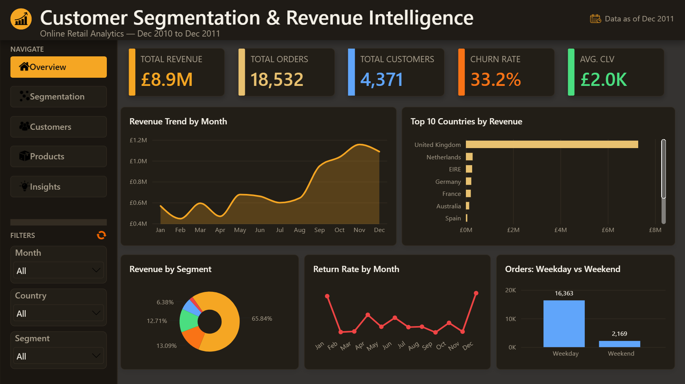
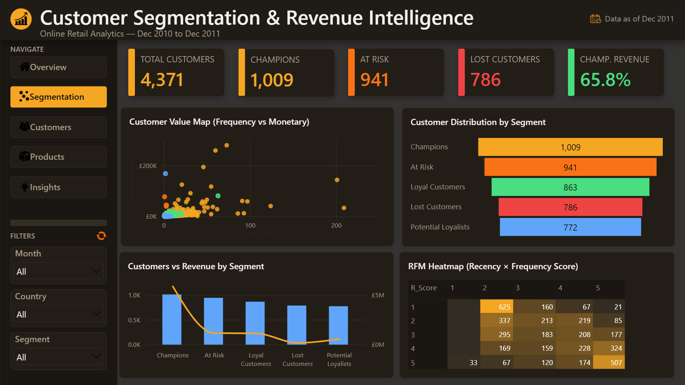
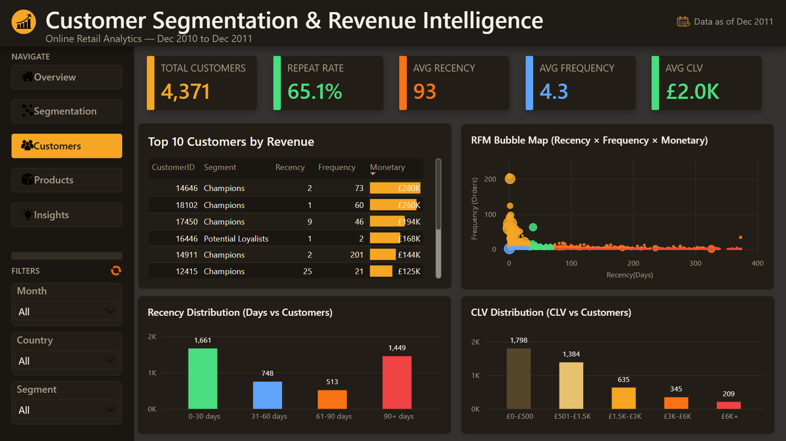
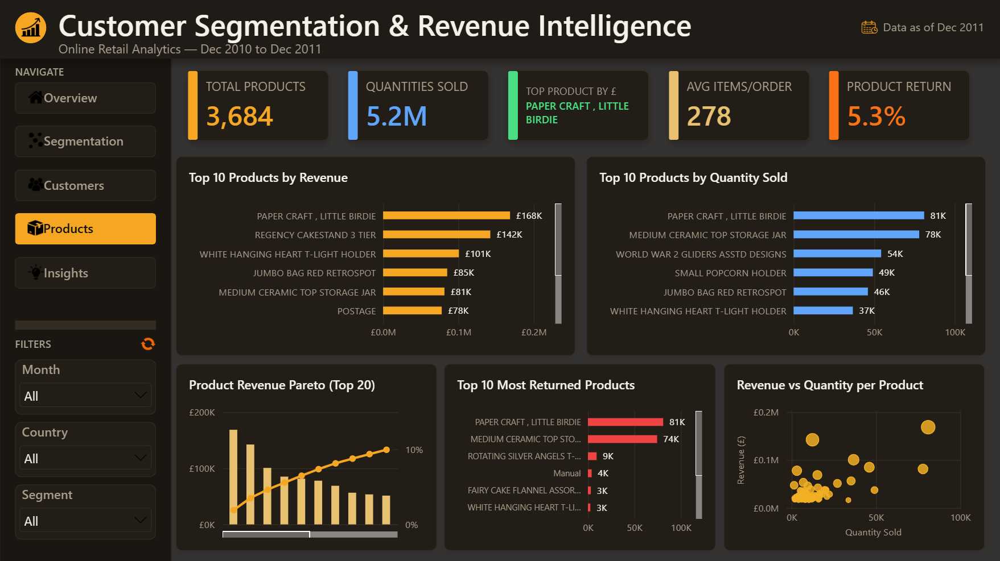
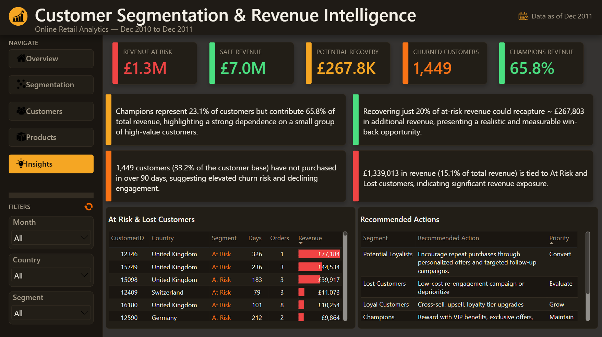
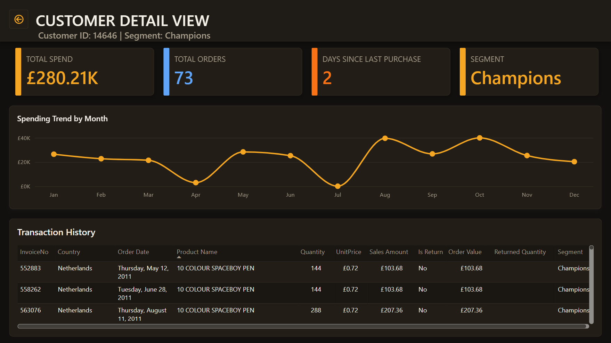
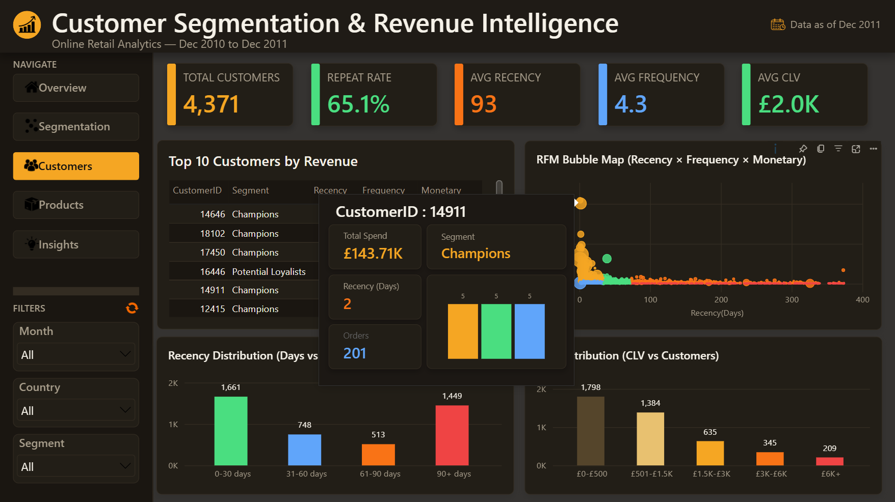
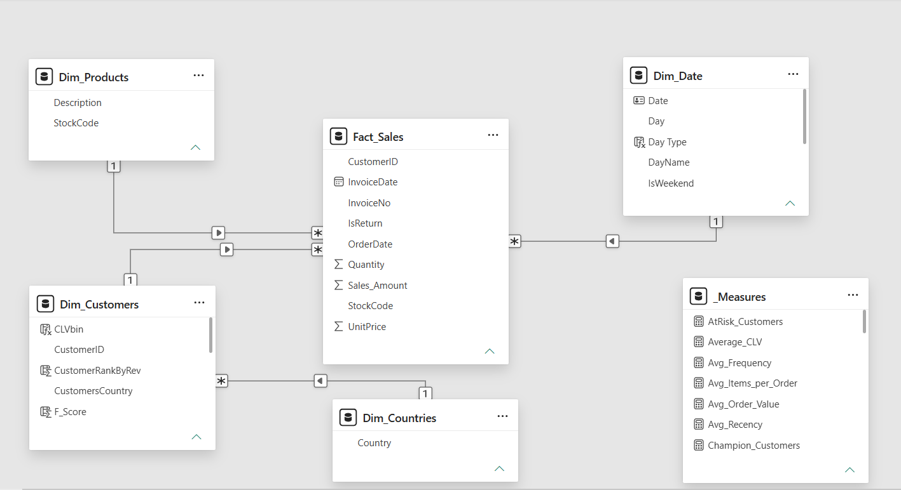

<div align="center">

# 🧩 Customer Segmentation & Revenue Analysis — Power BI Dashboard

### End-to-end RFM customer segmentation, revenue risk & churn intelligence dashboard built on the Online Retail (UCI) dataset

[](https://powerbi.microsoft.com/)
[](#-dax-measures)
[](#-etl--data-transformation)
[](#-data-model)
[](#-key-features)
[](#)

<br>


</div>

---

## 📑 Table of Contents

- [Overview](#-overview)
- [Key Features](#-key-features)
- [Dashboard Preview](#️-dashboard-preview)
- [Data Model](#️-data-model)
- [Customer Segmentation Logic (RFM)](#-customer-segmentation-logic-rfm)
- [DAX Measures](#-dax-measures)
- [ETL / Data Transformation](#-etl--data-transformation)
- [Tech Stack](#️-tech-stack)
- [Repository Structure](#-repository-structure)
- [How to Use](#-how-to-use)
- [Business Problem & Insights](#-business-problem--insights)
- [Key Insights (Summary)](#-key-insights-summary)
- [Deep-Dive Analysis](#-deep-dive-analysis)
- [Actionable Recommendations](#-actionable-recommendations)
- [Related Projects](#-related-projects)
- [Author](#-author)
- [License](#-license)

---

## 📌 Overview

This project is a **single-page, app-style interactive Power BI dashboard** built on the classic **Online Retail** dataset (UCI Machine Learning Repository) — a UK-based online retailer's transaction history from December 2010 to December 2011. It transforms ~542K raw transaction lines into a decision-ready customer intelligence suite covering **RFM segmentation, revenue concentration, churn risk, and product/return performance**.

Rather than a stack of static report pages connected by plain tabs, this dashboard is built as **one page with five swappable views**, driven entirely by Power BI Bookmarks and Buttons — giving it a genuine web-app feel: a fixed sidebar for navigation and filtering, and a content area that swaps instantly between Overview, Segmentation, Customers, Products, and Insights.

**This project is part of a three-tool analytics portfolio built on the same UK-based Online Retail dataset.**

This project uses the same Online Retail dataset as my [Excel]() and [SQL Server]() projects, demonstrating how the same business problem can be analyzed and solved using three different analytics tools: **Power BI, SQL Server, and Excel**.

The goal was to go beyond basic sales reporting and develop a customer-focused analytical solution that transforms transactional data into actionable insights. By leveraging **Power Query for data transformation, DAX for analytical calculations, and data modeling for structured analysis**, this project focuses on understanding customer value, identifying high-value and at-risk customer segments, evaluating revenue contribution, and uncovering opportunities to improve customer retention and business performance.

| | |
|---|---|
| 🗂️ **Records analyzed** | 541,909 raw rows → 406,789 cleaned transaction lines |
| 💰 **Total Revenue** | ~£8.91M |
| 📦 **Total Orders** | ~18,500 |
| 👥 **Customers** | 4,371 unique customers |
| 🛍️ **Products** | 3,684 unique SKUs |
| 🌎 **Coverage** | 37 countries |
| 📅 **Time Range** | Dec 2010 – Dec 2011 |
| 🎯 **Segments** | 5 RFM segments — Champions, Loyal Customers, Potential Loyalists, At Risk, Lost Customers |

---

## ✨ Key Features

- **Single-page "app" architecture** — 5 full views (Overview, Segmentation, Customers, Products, Insights) built on one page, switched via **Bookmarks + Buttons** rather than standard page tabs, with a persistent sidebar (navigation + global slicers) that never resets between views
- **49 custom DAX measures** — core KPIs, full RFM scoring engine (percentile-ranked R/F/M scores via `RANKX`), churn & retention metrics, cumulative revenue Pareto (80/20) curves for both customers and products, and dynamic DAX-generated insight sentences
- **RFM segmentation engine** built entirely in DAX — every customer scored 1–5 on Recency, Frequency, and Monetary value, then classified into 5 exhaustive, non-overlapping segments
- **Drillthrough page** — right-click any customer to jump to a dedicated Customer Details page with their full transaction history, spending trend, RFM profile, and a dynamically colour-coded segment card
- **Two custom Report Page tooltips** — hovering over the Top 10 Countries chart or the RFM scatter plot shows a rich mini-dashboard instead of Power BI's default tooltip
- **Dynamic, DAX-generated insight cards** — full sentences (e.g. *"Champions represent 23.2% of customers but contribute 65.9% of total revenue"*) that update automatically as the underlying data changes
- **Consistent custom dark theme ("Obsidian & Amber")** — hand-formatted (not a single theme file) across every visual, with a dedicated 5-colour segment palette used consistently across every chart, slicer, and card
- **Clean ETL pipeline in Power Query** — type casting, cancellation/return flagging, null-customer removal, invalid-price filtering, and a full star-schema split into fact + dimension tables

---

## 🖥️ Dashboard Preview

### 1️⃣ Overview
Headline KPIs (Total Revenue, Total Orders, Total Customers, Churn Rate, Average CLV), a **Revenue Trend by Month** area chart, **Top 10 Countries by Revenue**, a **Revenue by Segment** donut, **Return Rate by Month**, and **Orders: Weekday vs Weekend**.



### 2️⃣ Segmentation
The core RFM view: **Customer Value Map** (Frequency vs Monetary scatter, coloured by segment), **Customer Distribution by Segment**, **Customers vs Revenue by Segment** combo chart, and an **RFM Heatmap** (Recency Score × Frequency Score, conditionally formatted).



### 3️⃣ Customers
Customer-level deep dive: **Top 10 Customers by Revenue** (with data bars), **Recency Distribution**, an **RFM Bubble Map**, a **Customer Revenue Pareto (80/20)** chart, and **CLV Distribution**.



### 4️⃣ Products
Product-level performance: **Top 10 Products by Revenue**, **Top 10 Products by Quantity Sold**, a **Product Revenue Pareto**, **Returns by Product**, and **Revenue vs Quantity per Product**.



### 5️⃣ Insights & Actions
Dynamic, DAX-generated insight sentences, an **At-Risk & Lost Customers** table (drillthrough-enabled), and a **Recommended Action matrix** mapping each segment to a suggested retention action and priority level.



### 🔎 Customer Details (Drillthrough)
Right-click any customer anywhere in the report to land here — a full personal profile: spend, orders, days since last purchase, segment (dynamically colour-coded), a spending trend line, a location map, and complete transaction history.



### 💬 Custom Tooltips
Country-level and customer-level mini-dashboards that appear on hover over the Top 10 Countries chart and the RFM scatter plot, respectively.



---

## 🗃️ Data Model

The model follows a **star-schema** approach with one central fact table and four supporting dimension tables, plus a dedicated disconnected measures table.



| Table | Type | Description |
|---|---|---|
| **Fact_Sales** | Fact | ~406,789 rows — invoice line items: quantity, unit price, sales amount, return flag, order date, customer/product keys |
| **Dim_Customers** | Dimension | 4,371 rows — one per customer, with Recency/Frequency/Monetary values, R/F/M scores, and final Segment classification calculated as columns |
| **Dim_Products** | Dimension | 3,684 rows — one per unique product (StockCode + Description) |
| **Dim_Countries** | Dimension | 37 rows — one per unique country |
| **Dim_Date** | Dimension | DAX-generated calendar table (`CALENDAR()`), marked as an official Date Table |
| **_Measures** | Measure table | Dedicated (disconnected/empty) table used purely to organize all 49 DAX measures outside the fact/dimension tables |
| **Recommended_Action_Reference** | Reference | Small manually-entered table mapping each segment to a recommended action & priority, used on the Insights view |

**Key derived columns created in DAX** (on `Dim_Customers`):
- `Recency`, `Frequency`, `Monetary` — the three raw RFM inputs
- `R_Score`, `F_Score`, `M_Score` — 1–5 percentile-ranked scores via `RANKX`
- `Segment` — final 5-category classification (see below)
- `RecencyBin`, `CLVbin` — bucketed groupings used for distribution charts

---

## 🎯 Customer Segmentation Logic (RFM)

Every customer is scored 1–5 on Recency, Frequency, and Monetary value, then classified into exactly one of five segments — the logic is written to be exhaustive, so no customer is ever left unclassified:

| Segment | Definition | Customers | % of Revenue |
|---|---|---:|---:|
| 🏆 **Champions** | R≥4, F≥4, M≥4 | 1,012 | 65.9% |
| 💙 **Loyal Customers** | Mid-range across R/F/M (catch-all) | 863 | *[fill in]* |
| 🔵 **Potential Loyalists** | R≥4, not yet a Champion | 769 | *[fill in]* |
| 🟠 **At Risk** | R≤2, F≥3, M≥3 | 943 | *[fill in]* |
| 🔴 **Lost Customers** | R≤2, F≤2, M≤2 | 784 | *[fill in]* |

> Champions make up roughly **23% of the customer base** but drive nearly **two-thirds of total revenue** — a textbook Pareto concentration that shapes almost every recommendation in this project.

---

## 🧮 DAX Measures

A sample of the 49 measures used across the report (organized by category):
(Click on triangles)

<details>
<summary><strong>📌 Core KPIs</strong></summary>

```dax
Total_Revenue = CALCULATE(SUM(Fact_Sales[Sales_Amount]), Fact_Sales[IsReturn] = "No")

Return_Revenue = CALCULATE(SUM(Fact_Sales[Sales_Amount]), Fact_Sales[IsReturn] = "Yes")

Net_Revenue = SUM(Fact_Sales[Sales_Amount])

Total_Orders = CALCULATE(DISTINCTCOUNT(Fact_Sales[InvoiceNo]), Fact_Sales[IsReturn] = "No")

Total_Customers = DISTINCTCOUNT(Fact_Sales[CustomerID])

Avg_Order_Value = DIVIDE([Total_Revenue], [Total_Orders], 0)
```
</details>

<details>
<summary><strong>🎯 RFM Scoring Engine</strong></summary>

```dax
Recency =
VAR TodayDate = MAX(Fact_Sales[InvoiceDate]) + 1
VAR LastPurchase = CALCULATE(MAX(Fact_Sales[InvoiceDate]), Fact_Sales[IsReturn] = "No")
RETURN DATEDIFF(LastPurchase, TodayDate, DAY)

R_Score =
VAR R_Rank = RANKX(Dim_Customers, Dim_Customers[Recency], ,ASC, Skip)
VAR TotalCustomers = DISTINCTCOUNT(Dim_Customers[CustomerID])
VAR Percentile = R_Rank / TotalCustomers
RETURN
SWITCH(TRUE(), Percentile <= 0.2, 5, Percentile <= 0.4, 4, Percentile <= 0.6, 3, Percentile <= 0.8, 2, 1)

Segment =
SWITCH(
    TRUE(),
    Dim_Customers[R_Score] >= 4 && Dim_Customers[F_Score] >= 4 && Dim_Customers[M_Score] >= 4, "Champions",
    Dim_Customers[R_Score] >= 4, "Potential Loyalists",
    Dim_Customers[R_Score] <= 2 && Dim_Customers[F_Score] <= 2 && Dim_Customers[M_Score] <= 2, "Lost Customers",
    Dim_Customers[R_Score] <= 2, "At Risk",
    "Loyal Customers"
)
```
</details>

<details>
<summary><strong>📉 Churn, Retention & Revenue Risk</strong></summary>

```dax
Churned_Customers = CALCULATE(DISTINCTCOUNT(Fact_Sales[CustomerID]), Dim_Customers[Recency] > 90)

Churn_Rate% = DIVIDE([Churned_Customers], [Total_Customers], 0)

Repeate_Customer_Rate% = DIVIDE([Repeat_Customers], [Total_Customers], 0)

Revenue_At_Risk = CALCULATE([Total_Revenue], Dim_Customers[Segment] IN {"At Risk", "Lost Customers"})

Safe_Revenue = CALCULATE([Total_Revenue], Dim_Customers[Segment] IN {"Champions", "Loyal Customers"})

Potential_Recovery_Value = [Revenue_At_Risk] * 0.20
```
</details>

<details>
<summary><strong>📊 Pareto (80/20) Analysis</strong></summary>

```dax
Customer_Rank_by_Revenue =
RANKX(ALL(Dim_Customers[CustomerID]), CALCULATE(MAX(Dim_Customers[Monetary])), , DESC, Dense)

Cumulative_Customer_Revenue =
VAR PresentRank = [Customer_Rank_by_Revenue]
RETURN
CALCULATE(
    SUM(Dim_Customers[Monetary]),
    FILTER(ALL(Dim_Customers), RANKX(ALL(Dim_Customers), CALCULATE(SUM(Dim_Customers[Monetary])), ,DESC, DENSE) <= PresentRank)
)

Cumulative_Revenue% = DIVIDE([Cumulative_Customer_Revenue], CALCULATE(SUM(Dim_Customers[Monetary])), 0)
```
</details>

<details>
<summary><strong>💬 Dynamic Insight Text & Tooltip Measures</strong></summary>

```dax
Insight1_Champions =
"Champions represent " & FORMAT([Champions_Customers%], "0.0%") &
" of customers but contribute " & FORMAT([Champions_Revenue%], "0.0%") &
" of total revenue, highlighting a strong dependence on a small group of high-value customers."

Segment_Color =
SWITCH(
    SELECTEDVALUE(Dim_Customers[Segment]),
    "Champions", "#F5A623", "Loyal Customers", "#4ADE80", "Potential Loyalists", "#60A5FA",
    "At Risk", "#F97316", "Lost Customers", "#EF4444", "#A69C8A"
)

Tooltip_CustomerID = "CustomerID : " & SELECTEDVALUE(Dim_Customers[CustomerID], "Customer")
```
</details>

---

## 🔄 ETL / Data Transformation

Data is ingested from a CSV source and cleaned entirely in **Power Query (M)**, then split into a star schema:

- Type casting — `InvoiceNo`/`StockCode` to Text (to preserve cancellation-prefixed IDs), `UnitPrice` to Fixed Decimal Number
- Removed ~135,000 rows with a blank `CustomerID` (406,789 rows remained)
- Trimmed & cleaned the `Description` column
- Added an `IsReturn` flag (`Text.StartsWith([InvoiceNo], "C")`) to identify cancellations
- Filtered out zero/negative `UnitPrice` rows (data-entry artifacts)
- Added a `Sales_Amount` calculated column (`Quantity × UnitPrice`)
- Split the cleaned staging query into `Fact_Sales`, `Dim_Customers`, `Dim_Products`, `Dim_Countries` via Reference queries, each deduplicated on its key column

---

## 🛠️ Tech Stack

| Tool | Purpose |
|---|---|
| **Power BI Desktop** | Report authoring, data modeling, bookmark-driven UX, visualization |
| **DAX** | RFM scoring, segmentation logic, time intelligence, Pareto analysis, dynamic text |
| **Power Query (M)** | Data cleaning, transformation & star-schema construction (ETL) |
| **CSV (Online Retail, UCI)** | Source dataset |

---

## 📁 Repository Structure

```
Customer-Segmentation-Power-BI/
│
├── dashboard/
│   └── powerbi-customer-segmentation-analysis.pbix   # Main Power BI report file
├── raw data/
│   └── Online_Retail_Raw.csv                         # Source dataset
├── images/
│   ├── 01-overview.png
│   ├── 02-segmentation.png
│   ├── 03-customers.png
│   ├── 04-products.png
│   ├── 05-insights.png
│   ├── 06-drillthrough.png
│   ├── 07-tooltips.png
│   └── data-model.png
├── documentation/
│   └── Power_BI_Project_Documentation.docx           # Full build documentation
└── README.md
```

---

## 🚀 How to Use

1. Open `powerbi-customer-segmentation-analysis.pbix` in **Power BI Desktop** (free download [here](https://powerbi.microsoft.com/desktop/))
2. If prompted, update the data source path under **Transform Data → Data Source Settings** to point to your local copy of `Online_Retail_Raw.csv`
3. Click **Refresh** to load the data, then navigate the report using the in-report sidebar buttons (Overview, Segmentation, Customers, Products, Insights)
4. View the live, published version on the **Power BI Service**: *[Add Power BI Service link here]*

---

## 🧩 Business Problem & Insights

> **Business question:** *"Which customers are actually driving our revenue, which are at risk of leaving, and where should retention effort be focused to protect the most revenue for the least cost?"*

### The Concentration Problem

Revenue is not evenly spread across the customer base — it is heavily concentrated in a small top tier, while a large share of the remaining base is trending toward inactivity:

| Segment | Customers | % of Base | Revenue Share |
|---|---:|---:|---:|
| Champions | 1,012 | 23.2% | 65.9% |
| Loyal Customers | 863 | 19.7% | *[fill in]* |
| Potential Loyalists | 769 | 17.6% | *[fill in]* |
| At Risk | 943 | 21.6% | *[fill in]* |
| Lost Customers | 784 | 17.9% | *[fill in]* |

**39.5% of the customer base (At Risk + Lost Customers) represents real, quantifiable revenue exposure** — and with an overall churn rate of **33.2%** (customers with no purchase in 90+ days), the business is carrying meaningful retention risk sitting largely outside its most profitable segment.

---

## 📈 Key Insights (Summary)

- **Champions (23.2% of customers) generate 65.9% of total revenue** — a clear Pareto concentration that makes this segment the single highest-priority group to protect
- **Churn rate stands at 33.2%** — roughly 1 in 3 customers have gone quiet for 90+ days, a meaningful share of the base drifting toward full churn
- **£611.34K in return revenue** was recorded against £8.91M in gross revenue — a return rate worth monitoring at the product level (see Products view)
- **The United Kingdom dominates revenue** by a wide margin over every other of the 37 countries in the dataset, consistent with this being a UK-based retailer
- **Recovering just 20% of At-Risk revenue** represents a realistic, low-risk win-back target rather than an aggressive, unproven assumption
- **A small number of products and customers account for a disproportionate share of revenue** — confirmed via the dedicated Pareto (80/20) charts built for both customers and products
- **Returns are concentrated in a specific subset of products**, rather than spread evenly across the catalog (see the Top 10 Most Returned Products chart on the Products view)

---

## 🔍 Deep-Dive Analysis

### 🔴 Finding 1 — Revenue depends heavily on a small customer tier

Champions drive the large majority of revenue despite being under a quarter of the customer base. Any disruption to this segment — a competitor offer, a service issue, a pricing change — has an outsized effect on total revenue precisely because it is so concentrated. This is the clearest single insight in the dataset and the reason the Insights view leads with it.

### 🔴 Finding 2 — A third of the customer base is inactive

With a 90-day inactivity threshold, **33.2% of customers are currently churned**, and a further slice sits in the "At Risk" segment — recently active enough to still be reachable, but trending in the wrong direction on Recency. The RFM Heatmap and Recency Distribution charts (Segmentation & Customers views) make clear this is not a small edge case but a structural pattern in the customer base.

### 🔴 Finding 3 — Returns are not evenly distributed

£611.34K in returned revenue is material against an £8.91M revenue base. Rather than treating this as background noise, the **Returns by Product** chart isolates exactly which SKUs are driving the bulk of return volume — turning a single return-rate KPI into an actionable product-level list.

### 🔴 Finding 4 — Revenue concentration extends to products, not just customers

The Product Revenue Pareto chart shows the same 80/20-style concentration seen in customers: a relatively small set of products account for a large share of total product revenue, meaning inventory, marketing, and pricing attention is best directed disproportionately toward that top tier.

---

## ✅ Actionable Recommendations

| # | Segment | Recommendation | Priority |
|---|---|---|---|
| 1 | Champions | Reward with early access, exclusive offers, and referral incentives — protect the group responsible for 65.9% of revenue | Maintain |
| 2 | Loyal Customers | Upsell complementary products and invite into a loyalty-tier upgrade path | Grow |
| 3 | Potential Loyalists | Encourage a 2nd/3rd purchase with a targeted, time-limited follow-up offer | Nurture |
| 4 | At Risk | Launch a personalized win-back campaign (e.g. limited-time discount) before these customers fully churn | Urgent |
| 5 | Lost Customers | Run a low-cost re-engagement campaign; deprioritize spend on customers unlikely to return | Evaluate |
| 6 | All segments | Fix the drivers behind the 33.2% churn rate at the source (e.g. post-purchase engagement gaps) rather than only reacting after Recency lapses | Structural |
| 7 | Products | Investigate the top returned SKUs identified on the Products view for a quality, sizing, or listing-accuracy issue | Product |
| 8 | Reporting | Track Revenue at Risk and Potential Recovery Value as standing KPIs (already built into the Insights view) rather than only reviewing churn after the fact | Ongoing |

---

## 🔗 Related Projects

This project is part of a broader retail analytics portfolio. The same customer/business-analysis skillset is also demonstrated on the **Superstore** dataset across three different tools:

| Project | Tool | Link |
|---|---|---|
| 📊 Superstore Sales Analysis | Power BI | [github.com/shivanand-Mathapati-Analyst/powerbi-sales-analysis-project](https://github.com/shivanand-Mathapati-Analyst/powerbi-sales-analysis-project) |
| 🗄️ Superstore Sales Analysis | SQL Server | [github.com/shivanand-Mathapati-Analyst/sql-superstore-sales-analysis](https://github.com/shivanand-Mathapati-Analyst/sql-superstore-sales-analysis) |
| 📗 Superstore Sales Analysis | Excel | [github.com/shivanand-Mathapati-Analyst/excel-superstore-sales-analysis](https://github.com/shivanand-Mathapati-Analyst/excel-superstore-sales-analysis) |
| 📗 Customer Segmentation Analysis (this project's Excel counterpart) | Excel | *[Add link here]* |

---

## 👤 Author

**Shivanand S. Mathapati**

- 🌐 Portfolio: [shivanand-mathapati.vercel.app](https://shivanand-mathapati.vercel.app)
- 💼 LinkedIn: *[Add link here]*
- 📺 YouTube: *[Add link here]*
- ✉️ Email: *[Add email here]*

---

## 📄 License

This project is licensed under the **MIT License** — feel free to use the dashboard structure and DAX patterns for your own learning or portfolio projects. See [LICENSE](LICENSE) for details.

---

<div align="center">

⭐ **If you found this project useful, consider giving it a star!** ⭐

</div>
